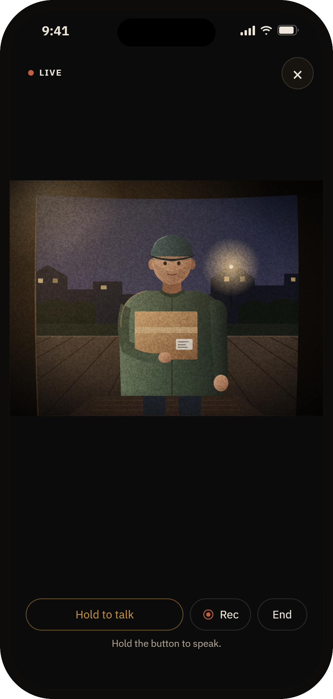
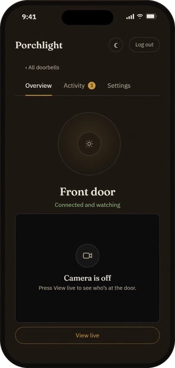
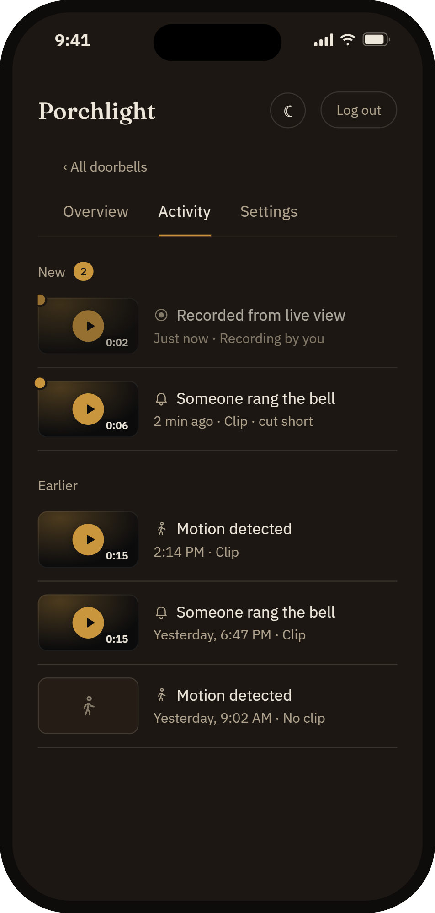
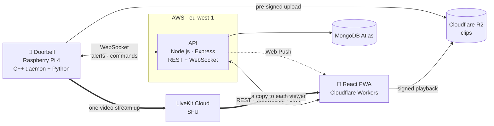

<div align="center">

# 🔔 Porchlight

**A Ring-style smart video doorbell, built end to end — from the Raspberry Pi at the door to the phone in your pocket.**

[](https://porchl.stream)
[](https://github.com/israellior/Smart-Home-Security-System-Device)


</div>

<p align="center">
  
  
  
</p>
<p align="center"><sub>The app's own screens and CSS, shown with sample data. The camera picture is an illustration.</sub></p>

## What it does

Someone rings the doorbell → every phone on that doorbell gets a notification, with the visitor's name if the doorbell knows them → you open the app, watch them live and talk back, from anywhere.

| | |
|---|---|
| 📹 **Live view and two-way talk** | 30 fps video and audio over WebRTC through a LiveKit SFU — many viewers, one upload from the Pi |
| 🔔 **Instant alerts** | Rings and motion as Web Push notifications, on Android and iPhone (installable PWA) |
| 🧍 **Person detection** | On-device TensorFlow Lite model, so a passing car does not wake your phone |
| 🙂 **Known faces** | Add people with a Face ID–style scan in the app; the doorbell recognizes them and rings by name |
| 🎞️ **Clips and activity** | Every ring and motion records a 15 s clip, and you can record from the live view; filter by rings / motion / recorded / saved, keep the ones that matter |
| 👥 **Shared households** | Owner and member roles, invite by code, per-person notification preferences |
| 🔄 **Remote management** | Move the doorbell to another Wi-Fi network and install signed over-the-air updates, from the app |

## Architecture



**Two rules shape everything:**

1. **The API carries no video and no clips.** Video goes through LiveKit; clips go straight from the Pi to storage on a pre-signed URL. Apart from small face photos on their way to storage, the server only issues credentials and records facts, so one small instance is enough.
2. **Alerts and clips travel on separate channels**, because they fail differently. A doorbell press must arrive in under a second; a 15 s clip is megabytes and can wait. On a single channel, an upload would delay a ring.

## Engineering highlights

- **Idempotent event ingest.** The device retries until it gets an answer, so the same press can arrive twice, and a ring can arrive *after* the motion event it upgrades. Both transports go through one `ingestEvent` path: a single MongoDB upsert, plus a compare-and-set that only ever raises motion → ring. Duplicates are silent, concurrent upgrades produce exactly one notification, and the event keeps the earliest sensor time regardless of arrival order.
- **Nothing is lost during a deploy.** The device keeps a bounded offline queue (200 alerts, 24 h, 2 s → 60 s backoff). The server answers *nothing* rather than *no* when it cannot write, because silence means "retry" and a rejection means "drop".
- **Security by design.** JWT auth with server-side revocation ("sign out everywhere"), bcrypt, per-email and per-IP login rate limits, per-device credentials checked in constant time, role checks on every device route, short-lived tokens for video and clips, and OTA bundles signed so even a compromised server cannot push firmware.
- **Production infrastructure as code.** ~40 resources in Terraform: 35 on AWS, plus the Cloudflare DNS records. The API runs as a Docker container behind Caddy (automatic TLS). No SSH port is open — shell and deploys go through AWS Systems Manager. Secrets live in SSM Parameter Store, and CI signs in to AWS with **OIDC**, so there are no AWS keys in GitHub.
- **Automated releases.** GitHub Actions builds the image, pushes to ECR, releases on the server, and verifies the deployment from the outside.

## Tech stack

| Layer | Technologies |
|---|---|
| Frontend | React, Vite, CSS Modules, Service Worker (PWA), Web Push, MediaPipe (in-browser face scan), LiveKit client |
| Backend | Node.js, Express, MongoDB / Mongoose (10 models), WebSocket signaling, JWT, bcrypt |
| Infrastructure | AWS (EC2, ECR, S3, SES, IAM, SSM, CloudWatch), Terraform, Docker, Caddy, Cloudflare (Workers, R2, DNS), LiveKit Cloud |
| CI/CD | GitHub Actions with OIDC, Dependabot |
| Device | C++20, Python, GStreamer, TensorFlow Lite, Buildroot — see the [device repo](https://github.com/israellior/Smart-Home-Security-System-Device) |

## Repository layout

| Path | What |
|---|---|
| [`src/`](src) | React app — live view, activity, sharing, faces, push, Wi-Fi and software settings |
| [`porchlight-backend/`](porchlight-backend) | REST API and WebSocket signaling — [full API reference](porchlight-backend/README.md) |
| [`infra/`](infra) | Terraform, server config and the production runbook — [infra README](infra/README.md) |
| [`.github/workflows/`](.github/workflows) | Build, release and verify pipeline |

## Running locally

```bash
# 1. Backend (needs a MongoDB connection string - see porchlight-backend/README.md)
cd porchlight-backend
cp .env.example .env
npm install
npm run dev            # http://localhost:4000

# 2. Web app
cd ..
npm install
npm run dev            # http://localhost:5173
```

Register an account, then add a doorbell: **Set up later** creates one with no hardware behind it. To point the app at another backend, copy `.env.example` to `.env.local` and set `VITE_API_URL`.

## What I'd do next

- **Scale past one API instance.** The socket registry, talk/record turns and the claim rate limiter live in process memory, which is why the API deliberately runs as a single instance. Moving that state to Redis would allow several instances behind a load balancer.
- **End-to-end tests** for the alert → push → live-view flow, running against a simulated device in CI.

## How it was built

Designed and built by me, from the first commit to production in under 4 weeks, using [Claude Code](https://claude.com/claude-code) as a pair programmer. The design decisions are written down in the device repo's [`DESIGN.md`](https://github.com/israellior/Smart-Home-Security-System-Device/blob/main/DESIGN.md) and [`docs/architecture.md`](https://github.com/israellior/Smart-Home-Security-System-Device/blob/main/docs/architecture.md).

---

<div align="center">
<b>Lior Israel</b> · <a href="https://www.linkedin.com/in/liorisrael1">LinkedIn</a> · <a href="https://github.com/israellior">GitHub</a>
</div>
